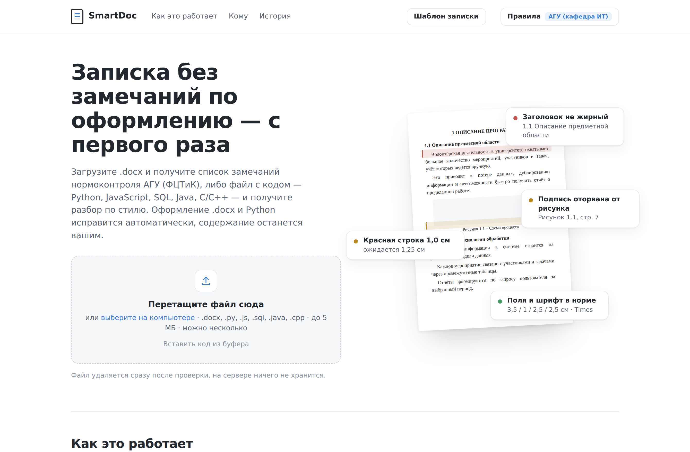
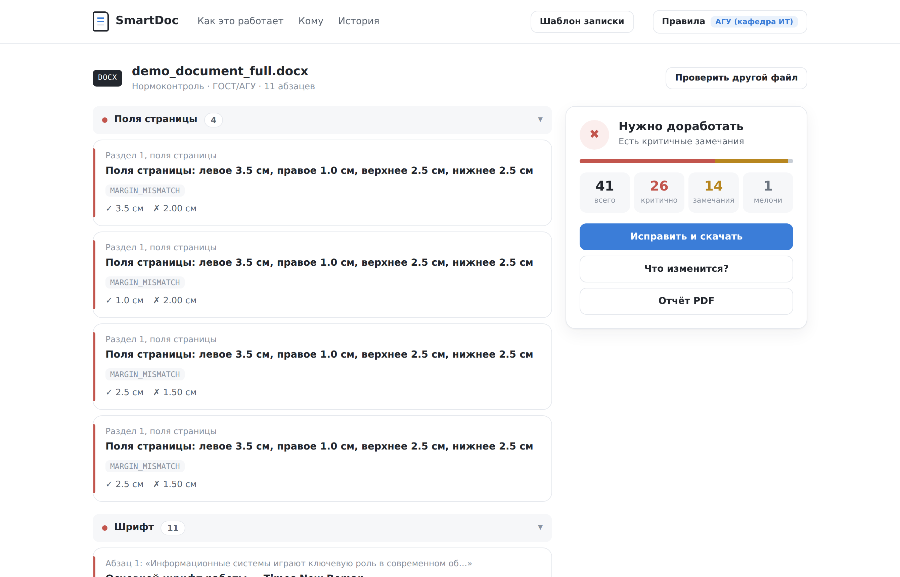
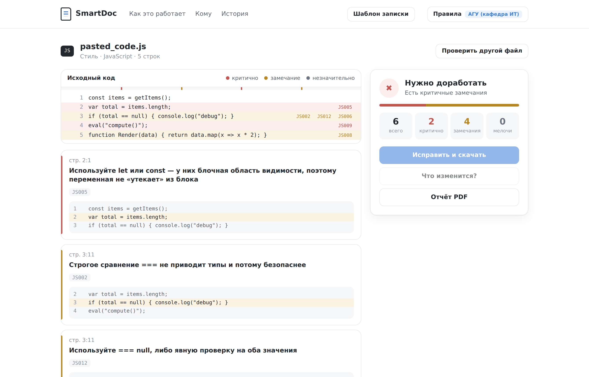
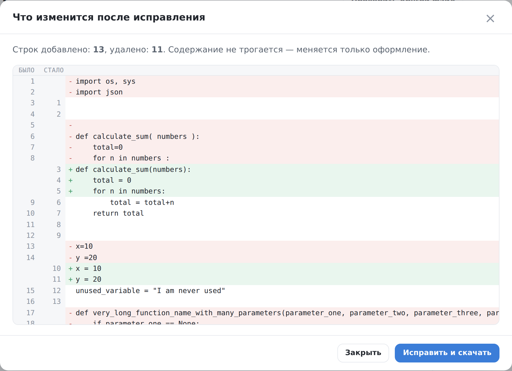

# SmartDoc & Code Review

Веб-сервис для проверки оформления документов .docx по требованиям вуза и проверки кода по стилю. Работает в браузере, регистрация не нужна.

[](https://github.com/poncikovdanila/SmartDoc/actions/workflows/ci.yml)
[](LICENSE)



## Зачем

Работы возвращают с нормоконтроля из-за полей, интервалов и подписей к рисункам. К содержанию это отношения не имеет, но отнимает по несколько заходов.

SmartDoc находит такие замечания за секунды и приводит оформление в порядок. Текст, титульный лист и структура документа при этом не меняются. Загруженный файл удаляется сразу после проверки.

По умолчанию проверка идёт по требованиям АГУ им. В. Н. Татищева, факультет ФЦТиК. Правила настраиваются: шрифт, кегль, поля, интервалы. Свой набор можно сохранить и выгрузить в JSON.

## Проверка .docx

Всего 38 видов замечаний. Каждое показывает место в документе, ожидаемое значение и фактическое.

| Группа | Что проверяется |
|---|---|
| Текст | шрифт, кегль, межстрочный интервал, красная строка, выравнивание по ширине |
| Страница | поля, нумерация страниц, лишние пустые строки и разрывы |
| Заголовки | полужирное начертание, точка в конце, последовательность нумерации |
| Объекты | подписи к рисункам и таблицам, отрыв подписи от объекта, шрифт внутри таблиц |
| Источники | наличие списка литературы, формат записей, год издания, гиперссылки |

Замечания показываются прямо в тексте. Документ отображается рядом со списком:
проблемные абзацы подсвечены по степени важности, счётчик справа показывает число
замечаний, клик по замечанию прокручивает к нужному месту. Искать «абзац 17» глазами
в Word больше не нужно.



## Проверка кода

| Формат | Чем проверяется | Автоисправление |
|---|---|---|
| `.py` | flake8, описания ошибок на русском | есть |
| `.js` | `var`, `==`, `eval`, `debugger`, забытый `console.log`, именование функций | нет |
| `.sql` | регистр ключевых слов, `SELECT *`, `DELETE` и `UPDATE` без `WHERE` | нет |
| `.java` | PascalCase классов, camelCase методов, пустой `catch`, отладочный вывод | нет |
| `.cpp` `.c` `.h` | `using namespace std`, `goto`, `malloc`, стандартный заголовок в кавычках | нет |

Чекеры для JS, SQL, Java и C/C++ встроенные. Node.js и JDK не нужны, достаточно `pip install`.

Перед применением правил из строки вычищаются строковые литералы и комментарии. Поэтому `var` в комментарии или `SELECT *` внутри кавычек замечанием не считаются.

Ошибки подсвечиваются прямо в исходном коде. Рядом с каждым замечанием показан фрагмент с соседними строками, по миникарте справа можно перейти к нужному месту.



## Автоисправление

Кнопка «Что изменится?» показывает результат до того, как файл будет изменён и скачан. Для кода строится построчный diff. Для .docx показывается сводка: сколько замечаний снимется и каких именно.



Исправление .docx меняет только то, что отклоняется от правил. Текст, титульный лист, колонтитулы, разрывы страниц и закладки остаются как были.

## Разбор списка литературы и объяснения

Необязательный слой, который подключается ключом Claude API. Он берёт на себя
то, где правила нечёткие и регулярками не описываются.

**Разбор списка литературы.** Библиографическая запись устроена по-разному
у книги, статьи и электронного ресурса, а знаки предписанной пунктуации
ставятся по позиции элемента, а не по шаблону. Для каждой записи определяется
вид источника и проверяются состав, порядок элементов и пунктуация. Там, где
данных в записи достаточно, предлагается исправленный вариант.

Стиль оформления выбирается: ГОСТ Р 7.0.100-2018, ГОСТ 7.1-2003,
ГОСТ Р 7.0.5-2008, APA 7, MLA 9, IEEE, Vancouver, Chicago. Если на кафедре
свои требования, их можно описать текстом: они будут важнее выбранного стиля.

**Объяснение замечания.** Кнопка у каждого замечания разворачивает сухую
формулировку правила в три части: что не так, почему такое требование
существует и как исправить вручную.

**Ассистент.** Панель в отчёте, где можно спросить про найденные замечания
обычными словами: что исправить в первую очередь, что придётся править
руками, что вообще значит это замечание. Ассистент не отвечает по памяти:
нужные сведения он берёт инструментами — сводка, список замечаний, текст
абзаца по номеру, поиск по документу, записи списка литературы. Под ответом
видно, чем он пользовался.

Инструменты только читают. Изменить документ ассистент не может — для этого
есть кнопка «Исправить и скачать» с детерминированным автоисправлением.
Переписка живёт в браузере: сервер между запросами ничего не хранит.

Что этому слою **не** поручается: поля, кегль, межстрочный интервал, красная
строка. Там python-docx даёт точное значение, а языковая модель внесла бы
только разброд: один и тот же документ начал бы давать разные ответы.

Пока поставщик модели не настроен, весь остальной сервис работает как прежде,
а кнопки и панель этого слоя просто не появляются. Поставщик выбирается
переменными окружения — ни одна строка остального кода от него не зависит:

```bash
# Claude
export ANTHROPIC_API_KEY=sk-ant-...

# любой OpenAI-совместимый API: DeepSeek, Qwen, OpenRouter
export AI_PROVIDER=openai
export AI_BASE_URL=https://api.deepseek.com
export AI_API_KEY=...
export AI_MODEL=deepseek-chat

# локальная модель через Ollama: ключ не нужен, наружу ничего не уходит
export AI_PROVIDER=openai
export AI_BASE_URL=http://localhost:11434/v1
export AI_MODEL=qwen2.5:14b

python run.py
```

Нужен пакет выбранного поставщика: `anthropic` для Claude, `openai` для
остальных (`pip install -r requirements-ai.txt` ставит оба). Если пакета нет,
слой честно отвечает, чего не хватает, а основные проверки продолжают
работать.

На разбор списка литературы уходит только сам список, на объяснение —
только текст замечания. Ассистенту доступен и текст документа: иначе он не
ответит, что именно не так в абзаце 12. Если отдавать текст работы наружу
нельзя, поднимите модель локально через Ollama — адрес задаётся той же
переменной.

## Что ещё умеет

* Пакетная проверка: несколько файлов за один раз, сводная таблица по каждому.
* Вставка кода из буфера по Ctrl+V, без создания файла.
* Отчёт в PDF с фрагментами кода рядом с каждым замечанием.
* Генерация шаблона записки .docx по текущим правилам.
* История последних 30 проверок в браузере.

## Запуск

```bash
git clone https://github.com/poncikovdanila/SmartDoc.git
cd SmartDoc
pip install -r requirements.txt
python run.py
```

Приложение откроется на http://127.0.0.1:8000

## Структура

| Путь | Назначение |
|---|---|
| `app/main.py` | маршруты FastAPI |
| `app/pdf_export.py` | отчёт в PDF, reportlab |
| `app/template_generator.py` | шаблон записки по текущим правилам |
| `app/checkers/code_checker.py` | Python через flake8 |
| `app/checkers/code_fixer.py` | автоисправление Python, autoflake и autopep8 |
| `app/checkers/multi_lang_checker.py` | JS, SQL, Java, C/C++ |
| `app/checkers/docx_checker.py` | нормоконтроль и пресеты правил |
| `app/checkers/docx_extras.py` | подписи, библиография, дополнительные проверки |
| `app/checkers/docx_fixer.py` | автоисправление .docx |
| `app/checkers/docx_preview.py` | структура документа для показа с подсветкой |
| `app/ai/providers.py` | сменный слой поставщиков модели |
| `app/ai/bibliography.py` | разбор списка литературы по выбранному стилю |
| `app/ai/assistant.py` | ассистент: диалог и читающие инструменты |
| `app/ai/explain.py` | объяснение замечания простым языком |
| `app/templates/`, `app/static/` | страница, стили, скрипты |

Фронтенд без фреймворков и сборки: один HTML, один CSS, один JS. Все проверки выполняются на сервере, файлы обрабатываются во временной папке.

Отчёт по коду и по документу имеет одинаковый формат: `filename`, `file_type`, `total_issues`, `summary`, `verdict`, `issues`, `source_lines`. Поэтому интерфейс, экспорт в PDF и история работают одинаково для всех языков и для .docx.

## API

| Метод | Путь | Что делает |
|---|---|---|
| `POST` | `/api/check` | проверка одного файла, возвращает JSON-отчёт |
| `POST` | `/api/check-batch` | пакетная проверка нескольких файлов |
| `POST` | `/api/autofix` | автоисправление, возвращает готовый файл |
| `POST` | `/api/autofix-preview` | что изменится: diff для кода, сводка для .docx |
| `POST` | `/api/export-pdf` | отчёт в PDF |
| `POST` | `/api/generate-template` | шаблон записки по текущим правилам |
| `GET` | `/api/presets` | пресеты правил для .docx |
| `GET` | `/api/languages` | поддерживаемые форматы и наличие автоисправления |
| `GET` | `/api/ai/status` | доступен ли слой ИИ и какие стили оформления есть |
| `POST` | `/api/ai/bibliography` | разбор списка литературы по стилю или требованиям |
| `POST` | `/api/ai/explain` | объяснение одного замечания |
| `POST` | `/api/ai/chat` | ход диалога с ассистентом по отчёту |
| `GET` | `/health` | health-check |

Эндпоинты, работающие с .docx, принимают необязательное поле `docx_rules` с пользовательскими правилами в JSON. Максимальный размер файла 5 МБ.

```bash
curl -F "file=@Записка.docx" http://127.0.0.1:8000/api/check | jq .summary
```

## Разработка

```bash
pip install -r requirements.txt -r requirements-dev.txt

pytest tests/ -q
flake8 app/
flake8 --select=E9,F63,F7,F82 tests/ benchmark/
```

Тесты и линтер прогоняются в GitHub Actions на Python 3.11 и 3.12, см. [`.github/workflows/ci.yml`](.github/workflows/ci.yml).

Отдельное внимание в тестах уделено ложным срабатываниям. Для каждого языка есть «чистый» файл с ловушками в комментариях и строках, который должен давать ноль замечаний. Ложное замечание обходится дороже пропущенного: пользователь перестаёт доверять отчёту.

Точность на реальных работах замеряется скриптом в [`benchmark/`](benchmark/).

## Деплой

Настройки для [Render](https://render.com) лежат в [`render.yaml`](render.yaml).

1. New → Web Service, подключить репозиторий, ветка `main`.
2. Добавить переменную окружения `ENV=production`, она отключает автоперезагрузку.
3. Через две-три минуты сервис доступен по публичной ссылке.

На бесплатном тарифе сервис засыпает после 15 минут простоя. Первый запрос после сна занимает до 30 секунд.

## Документация

* [Требования нормоконтроля АГУ ФЦТиК](docs/Требования_нормоконтроля_АГУ_ФЦТиК.md), полное описание проверяемых правил.
* [`benchmark/README.md`](benchmark/README.md), как замерить точность на своих файлах.

## Лицензия

[MIT](LICENSE). Результат проверки носит рекомендательный характер и не заменяет нормоконтроль кафедры.

## Автор

Данила Полстянов, poncikovdanila@gmail.com
